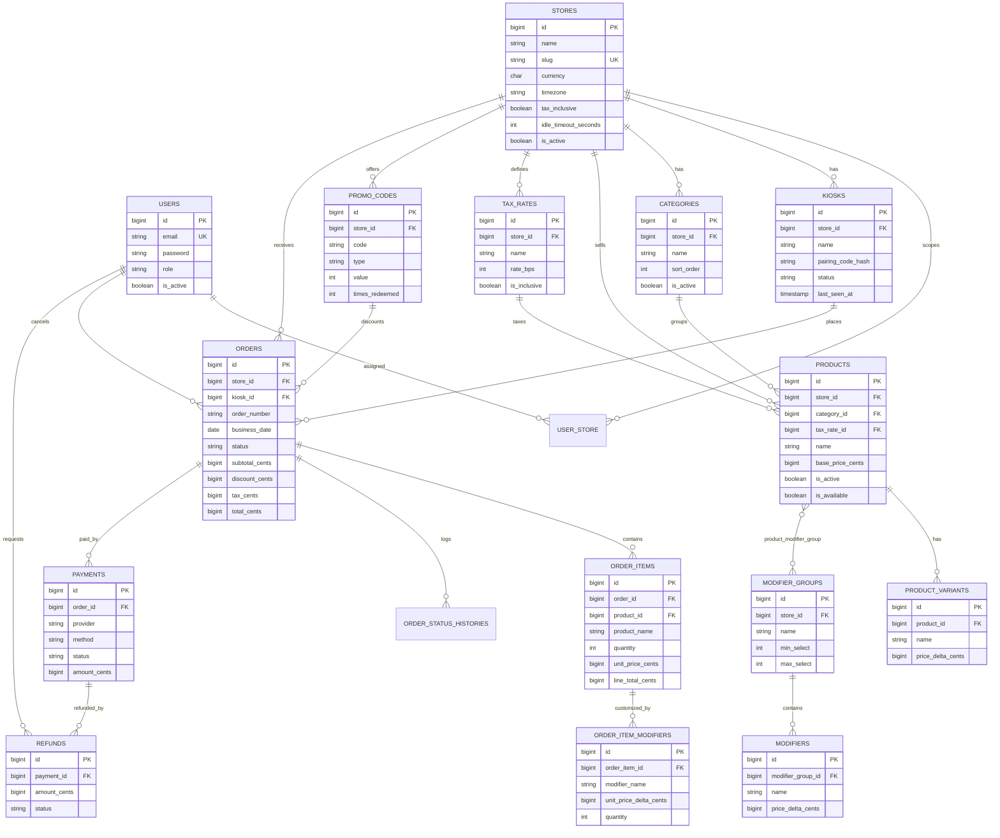

# Keyosk — Database Design

**Status:** Draft v1.0
**Last updated:** 2026-11-05
**Target:** MySQL 8.0+ (InnoDB, `utf8mb4_0900_ai_ci`)

---

## 1. Conventions

- Table names are plural `snake_case`; pivot tables are singular-alphabetical (`product_modifier_group`).
- Primary keys are `BIGINT UNSIGNED AUTO_INCREMENT` named `id`.
- Foreign keys are `<singular>_id`, `BIGINT UNSIGNED`, with explicit `ON DELETE` behaviour.
- All tables have `created_at` / `updated_at` (except append-only history tables, which have `created_at` only).
- Mutable catalog and staff tables use `deleted_at` (soft deletes).
- **Money** is `BIGINT` (not unsigned where deltas can be negative) in **minor units**.
- **Percentages/rates** are integer basis points: `825` = 8.25%, `1000` = 10%.
- Enums are stored as `VARCHAR(32)` with a PHP enum + DB `CHECK` constraint (MySQL 8.0.16+).
- JSON columns are used only for non-queried metadata (tags, settings, audit snapshots).
- Order data is immutable after payment except through explicit status/refund records.

---

## 2. Entity-relationship diagram



---

## 3. Tables

### 3.1 `stores`

| Column | Type | Null | Default | Notes |
| --- | --- | --- | --- | --- |
| id | BIGINT UNSIGNED PK | no | auto | |
| name | VARCHAR(120) | no | | |
| slug | VARCHAR(80) | no | | unique |
| address_line1 | VARCHAR(160) | yes | null | |
| address_line2 | VARCHAR(160) | yes | null | |
| city | VARCHAR(80) | yes | null | |
| region | VARCHAR(80) | yes | null | |
| postal_code | VARCHAR(20) | yes | null | |
| country | CHAR(2) | yes | null | ISO 3166-1 alpha-2 |
| phone | VARCHAR(32) | yes | null | |
| email | VARCHAR(160) | yes | null | Receipt "questions?" address |
| timezone | VARCHAR(64) | no | `UTC` | IANA name |
| currency | CHAR(3) | no | `USD` | ISO 4217 |
| locale | VARCHAR(10) | no | `en` | BCP 47 |
| tax_inclusive | BOOLEAN | no | false | Pricing display + math mode |
| receipt_footer | VARCHAR(500) | yes | null | |
| idle_timeout_seconds | SMALLINT UNSIGNED | no | 120 | 30–1800 |
| settings | JSON | yes | null | Remote config overrides |
| is_active | BOOLEAN | no | true | |
| created_at / updated_at | TIMESTAMP | no | | |
| deleted_at | TIMESTAMP | yes | null | soft delete |

Indexes: `UNIQUE(slug)`, `INDEX(is_active)`.

---

### 3.2 `users`

| Column | Type | Null | Default | Notes |
| --- | --- | --- | --- | --- |
| id | BIGINT UNSIGNED PK | no | auto | |
| name | VARCHAR(120) | no | | |
| email | VARCHAR(160) | no | | unique, lowercased |
| password | VARCHAR(255) | no | | bcrypt/argon2 hash |
| role | VARCHAR(32) | no | `cashier` | `admin`, `manager`, `cashier`, `kitchen` |
| is_active | BOOLEAN | no | true | |
| mfa_secret | VARCHAR(255) | yes | null | encrypted cast |
| last_login_at | TIMESTAMP | yes | null | |
| created_at / updated_at | TIMESTAMP | no | | |
| deleted_at | TIMESTAMP | yes | null | |

Indexes: `UNIQUE(email)`, `INDEX(role, is_active)`.

### 3.3 `user_store` (pivot)

| Column | Type | Null | Notes |
| --- | --- | --- | --- |
| user_id | BIGINT UNSIGNED FK → users | no | cascade on delete |
| store_id | BIGINT UNSIGNED FK → stores | no | cascade on delete |

Primary key `(user_id, store_id)`. Admins are not required to have rows (global scope); managers/cashiers/kitchen must have at least one.

---

### 3.4 `kiosks`

| Column | Type | Null | Default | Notes |
| --- | --- | --- | --- | --- |
| id | BIGINT UNSIGNED PK | no | auto | |
| store_id | BIGINT UNSIGNED FK → stores | no | | restrict on delete |
| name | VARCHAR(80) | no | | e.g. "Front counter left" |
| serial_number | VARCHAR(120) | yes | null | hardware identifier, unique when set |
| pairing_code_hash | VARCHAR(255) | yes | null | one-time, cleared after pairing |
| pairing_expires_at | TIMESTAMP | yes | null | |
| status | VARCHAR(32) | no | `pending` | `pending`, `active`, `disabled` |
| app_version | VARCHAR(32) | yes | null | reported by heartbeat |
| last_seen_at | TIMESTAMP | yes | null | offline if older than 90 s |
| settings | JSON | yes | null | per-device overrides |
| created_at / updated_at | TIMESTAMP | no | | |
| deleted_at | TIMESTAMP | yes | null | |

Indexes: `UNIQUE(serial_number)`, `INDEX(store_id, status)`, `INDEX(last_seen_at)`.
Tokens live in Laravel's `personal_access_tokens` (polymorphic `tokenable`). Tokens are hashed at rest by the framework and carry ability `kiosk`.

---

### 3.5 `tax_rates`

| Column | Type | Null | Default | Notes |
| --- | --- | --- | --- | --- |
| id | BIGINT UNSIGNED PK | no | auto | |
| store_id | BIGINT UNSIGNED FK → stores | no | | restrict |
| name | VARCHAR(80) | no | | e.g. "Sales tax" |
| rate_bps | SMALLINT UNSIGNED | no | | 0–10000 |
| is_inclusive | BOOLEAN | no | false | Overrides store default when set |
| is_default | BOOLEAN | no | false | At most one per store |
| created_at / updated_at | TIMESTAMP | no | | |

Indexes: `INDEX(store_id, is_default)`.

---

### 3.6 `categories`

| Column | Type | Null | Default | Notes |
| --- | --- | --- | --- | --- |
| id | BIGINT UNSIGNED PK | no | auto | |
| store_id | BIGINT UNSIGNED FK → stores | no | | cascade |
| name | VARCHAR(120) | no | | |
| slug | VARCHAR(120) | no | | |
| description | VARCHAR(500) | yes | null | |
| image_path | VARCHAR(255) | yes | null | object storage key |
| sort_order | SMALLINT UNSIGNED | no | 0 | |
| is_active | BOOLEAN | no | true | |
| created_at / updated_at | TIMESTAMP | no | | |
| deleted_at | TIMESTAMP | yes | null | |

Indexes: `UNIQUE(store_id, slug)`, `INDEX(store_id, is_active, sort_order)`.

---

### 3.7 `products`

| Column | Type | Null | Default | Notes |
| --- | --- | --- | --- | --- |
| id | BIGINT UNSIGNED PK | no | auto | |
| store_id | BIGINT UNSIGNED FK → stores | no | | redundant scope for integrity |
| category_id | BIGINT UNSIGNED FK → categories | no | | restrict delete |
| tax_rate_id | BIGINT UNSIGNED FK → tax_rates | no | | restrict delete |
| name | VARCHAR(140) | no | | |
| slug | VARCHAR(160) | no | | |
| sku | VARCHAR(64) | yes | null | unique per store when set |
| description | TEXT | yes | null | |
| base_price_cents | BIGINT UNSIGNED | no | 0 | variant deltas added |
| image_path | VARCHAR(255) | yes | null | |
| dietary_tags | JSON | yes | null | e.g. `["vegan","gluten_free"]` |
| allergens | JSON | yes | null | e.g. `["milk","nuts"]` |
| sort_order | SMALLINT UNSIGNED | no | 0 | |
| is_active | BOOLEAN | no | true | hidden from kiosk when false |
| is_available | BOOLEAN | no | true | manual "sold out" toggle |
| available_from | TIME | yes | null | reserved for scheduled availability |
| available_until | TIME | yes | null | reserved |
| created_at / updated_at | TIMESTAMP | no | | |
| deleted_at | TIMESTAMP | yes | null | |

Indexes: `UNIQUE(store_id, slug)`, `UNIQUE(store_id, sku)`, `INDEX(store_id, is_active, is_available, sort_order)`, `INDEX(category_id)`.
Constraint: `category.store_id = product.store_id` enforced in application layer (and a trigger if desired).

---

### 3.8 `product_variants`

| Column | Type | Null | Default | Notes |
| --- | --- | --- | --- | --- |
| id | BIGINT UNSIGNED PK | no | auto | |
| product_id | BIGINT UNSIGNED FK → products | no | | cascade |
| name | VARCHAR(80) | no | | e.g. "Large" |
| sku | VARCHAR(64) | yes | null | |
| price_delta_cents | BIGINT | no | 0 | signed; can be negative |
| is_default | BOOLEAN | no | false | exactly one default per product with variants |
| sort_order | SMALLINT UNSIGNED | no | 0 | |
| is_active | BOOLEAN | no | true | |
| created_at / updated_at | TIMESTAMP | no | | |
| deleted_at | TIMESTAMP | yes | null | |

Indexes: `UNIQUE(product_id, name)`, `INDEX(product_id, is_active)`.

---

### 3.9 `modifier_groups`

| Column | Type | Null | Default | Notes |
| --- | --- | --- | --- | --- |
| id | BIGINT UNSIGNED PK | no | auto | |
| store_id | BIGINT UNSIGNED FK → stores | no | | cascade |
| name | VARCHAR(120) | no | | e.g. "Choose milk" |
| description | VARCHAR(300) | yes | null | |
| min_select | TINYINT UNSIGNED | no | 0 | |
| max_select | TINYINT UNSIGNED | yes | null | null = unlimited |
| is_required | BOOLEAN | no | false | must agree with min_select > 0 |
| sort_order | SMALLINT UNSIGNED | no | 0 | |
| created_at / updated_at | TIMESTAMP | no | | |
| deleted_at | TIMESTAMP | yes | null | |

Indexes: `INDEX(store_id)`.
Constraint: `max_select IS NULL OR max_select >= min_select`.

### 3.10 `product_modifier_group` (pivot)

| Column | Type | Null | Notes |
| --- | --- | --- | --- |
| product_id | BIGINT UNSIGNED FK → products | no | cascade |
| modifier_group_id | BIGINT UNSIGNED FK → modifier_groups | no | cascade |
| sort_order | SMALLINT UNSIGNED | no | 0 |

Primary key `(product_id, modifier_group_id)`.

### 3.11 `modifiers`

| Column | Type | Null | Default | Notes |
| --- | --- | --- | --- | --- |
| id | BIGINT UNSIGNED PK | no | auto | |
| modifier_group_id | BIGINT UNSIGNED FK → modifier_groups | no | | cascade |
| name | VARCHAR(120) | no | | |
| price_delta_cents | BIGINT | no | 0 | signed |
| is_default | BOOLEAN | no | false | preselect in UI |
| sort_order | SMALLINT UNSIGNED | no | 0 | |
| is_active | BOOLEAN | no | true | |
| created_at / updated_at | TIMESTAMP | no | | |
| deleted_at | TIMESTAMP | yes | null | |

Indexes: `UNIQUE(modifier_group_id, name)`, `INDEX(modifier_group_id, is_active)`.

---

### 3.12 `promo_codes`

| Column | Type | Null | Default | Notes |
| --- | --- | --- | --- | --- |
| id | BIGINT UNSIGNED PK | no | auto | |
| store_id | BIGINT UNSIGNED FK → stores | no | | cascade |
| code | VARCHAR(40) | no | | stored uppercase, unique per store |
| description | VARCHAR(200) | yes | null | |
| type | VARCHAR(16) | no | | `percentage`, `fixed` |
| value | INT UNSIGNED | no | | bps for percentage (1000 = 10%), minor units for fixed |
| min_subtotal_cents | BIGINT UNSIGNED | no | 0 | |
| starts_at | TIMESTAMP | yes | null | |
| ends_at | TIMESTAMP | yes | null | |
| max_redemptions | INT UNSIGNED | yes | null | null = unlimited |
| times_redeemed | INT UNSIGNED | no | 0 | |
| is_active | BOOLEAN | no | true | |
| created_at / updated_at | TIMESTAMP | no | | |
| deleted_at | TIMESTAMP | yes | null | |

Indexes: `UNIQUE(store_id, code)`, `INDEX(store_id, is_active, starts_at, ends_at)`.
Redemption increments inside a transaction with `SELECT ... FOR UPDATE`.

---

### 3.13 `orders`

| Column | Type | Null | Default | Notes |
| --- | --- | --- | --- | --- |
| id | BIGINT UNSIGNED PK | no | auto | |
| store_id | BIGINT UNSIGNED FK → stores | no | | restrict |
| kiosk_id | BIGINT UNSIGNED FK → kiosks | yes | null | null for counter/staff orders |
| created_by_user_id | BIGINT UNSIGNED FK → users | yes | null | counter orders |
| order_number | VARCHAR(16) | no | | e.g. `A-0042` |
| business_date | DATE | no | | store-local date |
| status | VARCHAR(32) | no | `draft` | see enum below |
| channel | VARCHAR(16) | no | `kiosk` | `kiosk`, `counter` |
| currency | CHAR(3) | no | | snapshot of store currency |
| subtotal_cents | BIGINT UNSIGNED | no | 0 | sum of line totals |
| discount_cents | BIGINT UNSIGNED | no | 0 | |
| tax_cents | BIGINT UNSIGNED | no | 0 | |
| total_cents | BIGINT UNSIGNED | no | 0 | |
| promo_code_id | BIGINT UNSIGNED FK → promo_codes | yes | null | restrict delete |
| promo_code_snapshot | VARCHAR(40) | yes | null | denormalized for history |
| customer_name | VARCHAR(120) | yes | null | |
| customer_email | VARCHAR(160) | yes | null | for receipt |
| note | VARCHAR(500) | yes | null | |
| cancel_reason | VARCHAR(255) | yes | null | |
| idempotency_key | VARCHAR(64) | yes | null | supplied by client |
| expires_at | TIMESTAMP | yes | null | draft/pending TTL |
| placed_at | TIMESTAMP | yes | null | when submitted |
| paid_at | TIMESTAMP | yes | null | |
| completed_at | TIMESTAMP | yes | null | |
| cancelled_at | TIMESTAMP | yes | null | |
| created_at / updated_at | TIMESTAMP | no | | |

Indexes:
- `UNIQUE(store_id, business_date, order_number)`
- `UNIQUE(store_id, idempotency_key)` (NULLs allowed multiple times in MySQL)
- `INDEX(store_id, status, created_at)`
- `INDEX(store_id, business_date)`
- `INDEX(kiosk_id, created_at)`
- `INDEX(expires_at)` for expiry job

**Status enum:** `draft`, `pending_payment`, `paid`, `preparing`, `ready`, `completed`, `cancelled`, `refunded`.
**Allowed transitions:**

| From | To |
| --- | --- |
| draft | pending_payment, cancelled |
| pending_payment | paid, cancelled |
| paid | preparing, refunded, cancelled |
| preparing | ready, cancelled |
| ready | completed |
| completed | refunded |
| cancelled / refunded | (terminal) |

---

### 3.14 `order_items`

| Column | Type | Null | Default | Notes |
| --- | --- | --- | --- | --- |
| id | BIGINT UNSIGNED PK | no | auto | |
| order_id | BIGINT UNSIGNED FK → orders | no | | cascade |
| product_id | BIGINT UNSIGNED FK → products | yes | null | set null if hard-deleted |
| variant_id | BIGINT UNSIGNED FK → product_variants | yes | null | set null if hard-deleted |
| tax_rate_id | BIGINT UNSIGNED FK → tax_rates | yes | null | |
| product_name | VARCHAR(140) | no | | snapshot |
| variant_name | VARCHAR(80) | yes | null | snapshot |
| sku | VARCHAR(64) | yes | null | snapshot |
| unit_price_cents | BIGINT UNSIGNED | no | | product + variant + modifiers |
| quantity | SMALLINT UNSIGNED | no | 1 | 1–99 |
| line_subtotal_cents | BIGINT UNSIGNED | no | | unit × qty |
| line_discount_cents | BIGINT UNSIGNED | no | 0 | allocated share |
| line_tax_cents | BIGINT UNSIGNED | no | 0 | |
| line_total_cents | BIGINT UNSIGNED | no | | |
| note | VARCHAR(255) | yes | null | |
| created_at / updated_at | TIMESTAMP | no | | |

Indexes: `INDEX(order_id)`, `INDEX(product_id)`.

### 3.15 `order_item_modifiers`

| Column | Type | Null | Default | Notes |
| --- | --- | --- | --- | --- |
| id | BIGINT UNSIGNED PK | no | auto | |
| order_item_id | BIGINT UNSIGNED FK → order_items | no | | cascade |
| modifier_id | BIGINT UNSIGNED FK → modifiers | yes | null | set null if hard-deleted |
| modifier_group_name | VARCHAR(120) | no | | snapshot |
| modifier_name | VARCHAR(120) | no | | snapshot |
| unit_price_delta_cents | BIGINT | no | 0 | snapshot |
| quantity | TINYINT UNSIGNED | no | 1 | |
| line_total_cents | BIGINT | no | 0 | delta × qty |
| created_at / updated_at | TIMESTAMP | no | | |

Indexes: `INDEX(order_item_id)`.

---

### 3.16 `payments`

| Column | Type | Null | Default | Notes |
| --- | --- | --- | --- | --- |
| id | BIGINT UNSIGNED PK | no | auto | |
| order_id | BIGINT UNSIGNED FK → orders | no | | cascade |
| provider | VARCHAR(32) | no | | `stripe`, `cash`, `manual` |
| method | VARCHAR(16) | no | | `card`, `cash` |
| status | VARCHAR(32) | no | `requires_payment_method` | see enum |
| provider_intent_id | VARCHAR(120) | yes | null | e.g. Stripe PaymentIntent |
| provider_payment_id | VARCHAR(120) | yes | null | charge id |
| amount_cents | BIGINT UNSIGNED | no | | requested |
| captured_amount_cents | BIGINT UNSIGNED | no | 0 | |
| refunded_amount_cents | BIGINT UNSIGNED | no | 0 | |
| currency | CHAR(3) | no | | |
| failure_code | VARCHAR(80) | yes | null | |
| failure_message | VARCHAR(255) | yes | null | |
| idempotency_key | VARCHAR(64) | yes | null | |
| paid_at | TIMESTAMP | yes | null | |
| created_at / updated_at | TIMESTAMP | no | | |

Indexes:
- `UNIQUE(provider, provider_payment_id)`
- `UNIQUE(order_id, idempotency_key)`
- `INDEX(order_id, status)`
- `INDEX(status, created_at)`

**Status enum:** `requires_payment_method`, `processing`, `succeeded`, `failed`, `cancelled`, `partially_refunded`, `refunded`.

### 3.17 `refunds`

| Column | Type | Null | Default | Notes |
| --- | --- | --- | --- | --- |
| id | BIGINT UNSIGNED PK | no | auto | |
| payment_id | BIGINT UNSIGNED FK → payments | no | | restrict |
| order_id | BIGINT UNSIGNED FK → orders | no | | denormalized for reporting |
| requested_by_user_id | BIGINT UNSIGNED FK → users | yes | null | |
| approved_by_user_id | BIGINT UNSIGNED FK → users | yes | null | required above threshold |
| amount_cents | BIGINT UNSIGNED | no | | > 0 |
| reason | VARCHAR(255) | yes | null | |
| status | VARCHAR(16) | no | `pending` | `pending`, `succeeded`, `failed` |
| provider_refund_id | VARCHAR(120) | yes | null | |
| failure_message | VARCHAR(255) | yes | null | |
| created_at / updated_at | TIMESTAMP | no | | |

Indexes: `INDEX(payment_id)`, `INDEX(order_id)`, `UNIQUE(provider_refund_id)`.
Invariant: `SUM(succeeded refunds.amount_cents) <= payments.captured_amount_cents`.

---

### 3.18 `order_status_histories` (append-only)

| Column | Type | Null | Notes |
| --- | --- | --- | --- |
| id | BIGINT UNSIGNED PK | no | auto |
| order_id | BIGINT UNSIGNED FK → orders | no | cascade |
| from_status | VARCHAR(32) | yes | null on creation |
| to_status | VARCHAR(32) | no | |
| actor_type | VARCHAR(16) | yes | `kiosk`, `user`, `system` |
| actor_id | BIGINT UNSIGNED | yes | kiosk/user id, no FK (polymorphic) |
| reason | VARCHAR(255) | yes | |
| created_at | TIMESTAMP | no | |

Indexes: `INDEX(order_id, created_at)`.

### 3.19 `audit_logs` (append-only)

| Column | Type | Null | Notes |
| --- | --- | --- | --- |
| id | BIGINT UNSIGNED PK | no | auto |
| store_id | BIGINT UNSIGNED | yes | |
| actor_type | VARCHAR(16) | yes | `user`, `kiosk`, `system` |
| actor_id | BIGINT UNSIGNED | yes | |
| action | VARCHAR(80) | no | e.g. `product.updated` |
| entity_type | VARCHAR(80) | yes | |
| entity_id | BIGINT UNSIGNED | yes | |
| before | JSON | yes | |
| after | JSON | yes | |
| ip_address | VARCHAR(45) | yes | |
| user_agent | VARCHAR(255) | yes | |
| created_at | TIMESTAMP | no | |

Indexes: `INDEX(store_id, created_at)`, `INDEX(actor_type, actor_id)`, `INDEX(action, created_at)`, `INDEX(entity_type, entity_id)`.

### 3.20 Framework tables

Standard Laravel tables also present: `personal_access_tokens`, `password_reset_tokens`, `sessions`, `cache`, `cache_locks`, `jobs`, `job_batches`, `failed_jobs`, `migrations`.

---

## 4. Total calculation algorithm

Authoritative implementation lives in a single service (`OrderTotalsCalculator`), used by both preview and persistence.

```
for each cart line:
    unit = product.base_price + variant.delta + Σ(modifier.delta × modifier.qty)
    line_subtotal = unit × qty

subtotal = Σ line_subtotal
discount = min(apply_promo(subtotal), subtotal)          // promo: bps or fixed
discounted_subtotal = subtotal − discount

// allocate discount proportionally to lines (largest-remainder rounding)
for each line:
    line_discount = round(discounted allocation)
    taxable_base = line_subtotal − line_discount

if tax_inclusive:
    line_tax   = round(taxable_base × rate_bps / (10000 + rate_bps))
    line_total = taxable_base
else:
    line_tax   = round(taxable_base × rate_bps / 10000)
    line_total = taxable_base + line_tax

tax   = Σ line_tax
total = subtotal − discount + tax
```

Rules:
- Round half-up to the nearest minor unit per line; adjust the largest line for any residual so `Σ line_total == total`.
- The API stores and returns integer amounts only.
- `discount_cents`, `tax_cents`, `total_cents` are recomputed server-side and compared against any client preview; mismatch returns `422 TOTAL_MISMATCH`.

---

## 5. Data integrity rules

1. `products.store_id` must equal `categories.store_id` and `tax_rates.store_id`.
2. A product with variants must have exactly one active default variant.
3. `modifier_groups.max_select` is null (unlimited) or `>= min_select`; `is_required` implies `min_select > 0`.
4. An order's `kiosk_id`, when set, must belong to the same `store_id`.
5. `order_number` is generated under a per-store row lock / atomic sequence; uniqueness is enforced by the DB.
6. Payment `captured_amount_cents <= amount_cents`; refunds cannot exceed captured minus already refunded.
7. Orders in `paid` or later cannot have line items modified; transitions only via the state machine.
8. Soft-deleted products/categories/modifiers remain readable through order snapshots.
9. Deleting a store is blocked while orders exist (restrict).
10. `business_date` is derived from `stores.timezone`, not server time.

---

## 6. Migration order

1. `stores`
2. `users`, `user_store`
3. `tax_rates`, `categories`, `products`, `product_variants`
4. `modifier_groups`, `modifiers`, `product_modifier_group`
5. `kiosks`
6. `promo_codes`
7. `orders`, `order_items`, `order_item_modifiers`, `order_status_histories`
8. `payments`, `refunds`
9. `audit_logs`
10. Framework tables (Laravel defaults)

Each migration must have a working `down()`; destructive changes require a separate cleanup migration.

---

## 7. Seed data

`DatabaseSeeder` creates an idempotent demo dataset:

- One store: "Keyosk Demo — Downtown", USD, tax-exclusive, 8.25% tax.
- Users: `admin@keyosk.test` (admin), `manager@keyosk.test`, `cashier@keyosk.test`, `kitchen@keyosk.test` — known dev password from env only.
- One active kiosk "Kiosk 1" with a printed pairing code in local/dev output.
- Categories: Coffee, Tea, Bakery, Cold Drinks.
- 12 products with 2–4 variants and 3 modifier groups (milk, size extras, syrups).
- Two promo codes: `WELCOME10` (10% off), `SAVE2` ($2 off, min $10).
- No seeded orders; a separate `DemoOrderSeeder` can generate orders for reporting tests.

Seeders must never run in production (`APP_ENV=production` guard).

---

## 8. Retention and archival

| Data | Retention | Notes |
| --- | --- | --- |
| Orders, payments, refunds | 7 years (configurable) | Financial record |
| Customer name/email | 90 days, then nulled | PII minimization job |
| Audit logs | 2 years | Append-only |
| Kiosk heartbeat/app version | 30 days | Only `last_seen_at` in v1 |
| Failed jobs | 30 days | Laravel prune |
| Personal access tokens | Revoked/expired pruned daily | Laravel `sanctum:prune-expired` |

Archival job moves closed orders older than the retention window to cold storage, preserving aggregates for reports.
