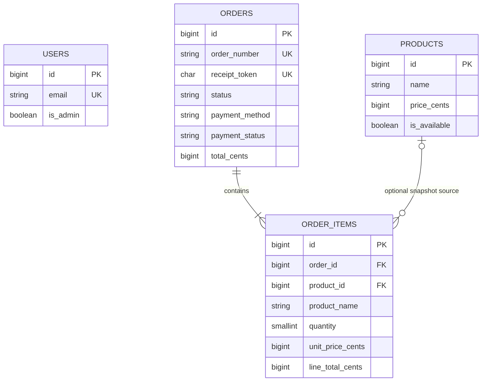

# Keyosk — Database Design

**Status:** Implemented and migrated (`keyosk`, `keyosk_test`)  
**Last updated:** 2026-11-06  
**Database:** PostgreSQL 14+ (`pgsql`)  
**Application database:** `keyosk`  
**Test database:** `keyosk_test`  
**Framework:** Laravel 13, Sanctum

This document replaces the previous full-kiosk design. It covers only the confirmed simplified scope: a public storefront, guest checkout, cash or mock online payment, a printable receipt, Sanctum admin login, product management, and basic order management.

> This design is paired with the simplified requirements, API contract, and implementation plan in the same `docs/` directory.

---

## 1. Confirmed rules

These are fixed by `docs/REQUIREMENTS.md` and must not be changed without approval:

- PostgreSQL is the only database. Do not reset or drop an existing database without approval.
- Customers do not have accounts. Admin users authenticate with Sanctum bearer tokens.
- Admin access is controlled by a boolean `users.is_admin` flag.
- Products have a name, optional description, price, optional image URL, and a single availability toggle.
- There is no inventory or stock counting. Availability is only a boolean.
- Money is stored as integer minor units (cents). Floating-point money is prohibited.
- Product prices, line totals, and order totals must never be negative.
- Quantity is an integer from 1 to 99.
- Duplicate product lines in one order are rejected.
- An order must contain at least one item.
- Product name, unit price, quantity, and line total are snapshotted on each order item.
- Order creation runs in a database transaction and recalculates all prices server-side.
- The order number is unique and human-readable. The receipt number is the same value; no separate receipt number is stored.
- A separate public receipt token is unique and unguessable.
- Deleting a product must not delete or modify historical order items.
- Cash orders are created `unpaid`; an admin may mark them `paid`.
- Mock online orders are created `paid` with a mock payment reference. No real payment provider or webhook exists.
- Order status is `pending`, `completed`, or `cancelled`.
- There are no taxes, discounts, promos, delivery fees, tips, refunds, customer accounts, stores, kiosks, variants, modifiers, categories, or audit tables.

---

## 2. Entities and relationships

| Table | Purpose |
| --- | --- |
| `users` | Existing Laravel user table plus `is_admin`; admin accounts only. |
| `products` | Sellable catalog items. |
| `orders` | One checkout: order number, receipt token, payment fields, status, total. |
| `order_items` | Immutable line snapshots belonging to an order. |

No additional supporting tables are required. In particular, there is no `payments` table: the scope has exactly one payment per order and the payment is mocked. If a real payment provider is added later, introduce a separate `payments` table at that time.

### ER diagram



`users` has no foreign-key relationship to orders or products: customers are guests, and admin actions are not audited in this scope. `order_items.product_id` is nullable so a product can be hard-deleted after an order exists.

---

## 3. Conventions

- Table names are plural `snake_case`; primary keys are `BIGINT` named `id`.
- Foreign keys are `<singular>_id` and `BIGINT`.
- New tables use `TIMESTAMPTZ` for timestamps. Existing framework tables are left unchanged.
- New audit timestamp columns (`created_at`, `updated_at`) are `NOT NULL DEFAULT now()`; nullable business timestamps such as `paid_at` are noted explicitly. In Laravel, use `->useCurrent()` (and make the column non-nullable); `timestampsTz()` alone produces nullable columns without a default. `order_items` has only `created_at` because order items are immutable.
- Enumerations use `VARCHAR` plus a named `CHECK` constraint, not PostgreSQL enum types.
- Money uses `BIGINT` minor units plus `CHECK` constraints. PostgreSQL does not enforce Laravel's `unsigned` modifier, so explicit checks are required.
- There are no soft deletes and no `deleted_at` columns.
- There is no stock column, so negative stock cannot occur. Availability is only `products.is_available`.
- `CHECK` constraints should be added with `DB::statement('ALTER TABLE ... ADD CONSTRAINT ... CHECK (...)')` after `Schema::create()`; this keeps constraint names explicit and works on PostgreSQL.

---

## 4. Tables

### 4.1 `users` (existing table, one new column)

The existing migration `0001_01_01_000000_create_users_table.php` already provides:

`id` (BIGINT primary key), `name`, `email` (unique), `email_verified_at`, `password`, `remember_token`, `created_at`, `updated_at`.

Add only:

| Column | PostgreSQL type | Laravel type | Null | Default | Constraints / notes |
| --- | --- | --- | --- | --- | --- |
| `is_admin` | `BOOLEAN` | `boolean` | no | `false` | Required by admin middleware. Existing rows backfill to `false`. |

No index is required for `is_admin`; admin login looks up `email`, which is already unique. Only admin accounts are expected in this scope; there is no role table and no `role` column. A `false` flag simply denies admin routes.

### 4.2 `products`

| Column | PostgreSQL type | Laravel type | Null | Default | Constraints / notes |
| --- | --- | --- | --- | --- | --- |
| `id` | `BIGINT` | `$table->id()` | no | identity | Primary key. |
| `name` | `VARCHAR(140)` | `$table->string('name', 140)` | no | — | `CHECK (btrim(name) <> '')`. |
| `description` | `TEXT` | `$table->text('description')` | yes | `null` | Optional. |
| `price_cents` | `BIGINT` | `$table->bigInteger('price_cents')` | no | — | `CHECK (price_cents >= 0)`. |
| `image_url` | `VARCHAR(2048)` | `$table->string('image_url', 2048)` | yes | `null` | Optional URL; no file upload/storage in scope. |
| `is_available` | `BOOLEAN` | `$table->boolean('is_available')` | no | `true` | Storefront lists only `true`; admin lists all. |
| `created_at` | `TIMESTAMPTZ` | `$table->timestampTz('created_at')` | no | `now()` | |
| `updated_at` | `TIMESTAMPTZ` | `$table->timestampTz('updated_at')` | no | `now()` | |

Constraints:

```sql
ALTER TABLE products ADD CONSTRAINT products_name_check
    CHECK (btrim(name) <> '');

ALTER TABLE products ADD CONSTRAINT products_price_cents_check
    CHECK (price_cents >= 0);
```

Indexes:

- `INDEX products_is_available_name_index (is_available, name)` — supports the public available-product listing and name ordering.
- No unique constraint on `name`; duplicate product names are allowed. See open questions.

### 4.3 `orders`

| Column | PostgreSQL type | Laravel type | Null | Default | Constraints / notes |
| --- | --- | --- | --- | --- | --- |
| `id` | `BIGINT` | `$table->id()` | no | identity | Primary key. |
| `order_number` | `VARCHAR(32)` | `$table->string('order_number', 32)->storedAs(...)` | no | generated from `id` | Unique. Also the receipt number. |
| `receipt_token` | `CHAR(64)` | `$table->char('receipt_token', 64)` | no | — | Unique, unguessable public receipt token. Generated by the application. |
| `status` | `VARCHAR(16)` | `$table->string('status', 16)` | no | `'pending'` | `pending`, `completed`, `cancelled`. |
| `payment_method` | `VARCHAR(16)` | `$table->string('payment_method', 16)` | no | — | `cash`, `online`. Required; no default. |
| `payment_status` | `VARCHAR(16)` | `$table->string('payment_status', 16)` | no | `'unpaid'` | `unpaid`, `paid`. |
| `payment_reference` | `VARCHAR(64)` | `$table->string('payment_reference', 64)` | yes | `null` | Mock reference only, e.g. `MOCK-<ULID>`. Required for `online`. |
| `total_cents` | `BIGINT` | `$table->bigInteger('total_cents')` | no | — | Sum of line totals; `CHECK (total_cents >= 0)`. |
| `paid_at` | `TIMESTAMPTZ` | `$table->timestampTz('paid_at')` | yes | `null` | Set for online orders at creation and when an admin marks cash paid. |
| `created_at` | `TIMESTAMPTZ` | `$table->timestampTz('created_at')` | no | `now()` | |
| `updated_at` | `TIMESTAMPTZ` | `$table->timestampTz('updated_at')` | no | `now()` | |

`order_number` is a PostgreSQL generated column derived from the primary key:

```sql
order_number VARCHAR(32)
    GENERATED ALWAYS AS (
        'ORD-' || lpad(id::text, greatest(6, length(id::text)), '0')
    ) STORED
```

`lpad(..., greatest(6, length(...)), '0')` pads to a minimum of six digits and does not truncate values above 999999. The primary-key sequence is concurrency-safe. Gaps are allowed and expected when a transaction rolls back; numbers are never reused. The order number is derived from the internal ID but is not used as a security boundary; public receipt access still requires `receipt_token`.

Laravel equivalent: define `$table->id()` before `$table->string('order_number', 32)->storedAs("'ORD-' || lpad(id::text, greatest(6, length(id::text)), '0')")`. Never include `order_number` in an insert or update payload.

Constraints:

```sql
ALTER TABLE orders ADD CONSTRAINT orders_status_check
    CHECK (status IN ('pending', 'completed', 'cancelled'));

ALTER TABLE orders ADD CONSTRAINT orders_payment_method_check
    CHECK (payment_method IN ('cash', 'online'));

ALTER TABLE orders ADD CONSTRAINT orders_payment_status_check
    CHECK (payment_status IN ('unpaid', 'paid'));

ALTER TABLE orders ADD CONSTRAINT orders_total_cents_check
    CHECK (total_cents >= 0);

ALTER TABLE orders ADD CONSTRAINT orders_online_paid_check
    CHECK (payment_method <> 'online' OR payment_status = 'paid');

ALTER TABLE orders ADD CONSTRAINT orders_online_reference_check
    CHECK (payment_method <> 'online' OR payment_reference IS NOT NULL);

ALTER TABLE orders ADD CONSTRAINT orders_paid_at_check
    CHECK (
        (payment_status = 'paid' AND paid_at IS NOT NULL)
        OR (payment_status = 'unpaid' AND paid_at IS NULL)
    );

ALTER TABLE orders ADD CONSTRAINT orders_order_number_format_check
    CHECK (order_number ~ '^ORD-[0-9]{6,}$');

ALTER TABLE orders ADD CONSTRAINT orders_receipt_token_format_check
    CHECK (receipt_token ~ '^[0-9a-f]{64}$');
```

Indexes / unique constraints:

- `UNIQUE (order_number)` — order number and receipt number.
- `UNIQUE (receipt_token)` — public receipt lookup.
- `INDEX orders_created_at_index (created_at)` — default admin order list.
- `INDEX orders_status_created_at_index (status, created_at)` — admin status filter.
- `INDEX orders_payment_status_created_at_index (payment_status, created_at)` — unpaid/paid filter.

No foreign key to `users`: orders are guest orders, and admin actions are not recorded in this scope.

### 4.4 `order_items`

| Column | PostgreSQL type | Laravel type | Null | Default | Constraints / notes |
| --- | --- | --- | --- | --- | --- |
| `id` | `BIGINT` | `$table->id()` | no | identity | Primary key. |
| `order_id` | `BIGINT` | `$table->foreignId('order_id')` | no | — | FK → `orders.id`, `ON DELETE RESTRICT`. |
| `product_id` | `BIGINT` | `$table->foreignId('product_id')->nullable()` | yes | `null` | FK → `products.id`, `ON DELETE SET NULL`. |
| `product_name` | `VARCHAR(140)` | `$table->string('product_name', 140)` | no | — | Snapshot at checkout. `CHECK (btrim(product_name) <> '')`. |
| `quantity` | `SMALLINT` | `$table->smallInteger('quantity')` | no | — | `CHECK (quantity BETWEEN 1 AND 99)`. |
| `unit_price_cents` | `BIGINT` | `$table->bigInteger('unit_price_cents')` | no | — | Snapshot at checkout; `CHECK (unit_price_cents >= 0)`. |
| `line_total_cents` | `BIGINT` | `$table->bigInteger('line_total_cents')` | no | — | Snapshot; must equal `unit_price_cents * quantity`. |
| `created_at` | `TIMESTAMPTZ` | `$table->timestampTz('created_at')` | no | `now()` | Immutable; no `updated_at`. |

Constraints:

```sql
ALTER TABLE order_items ADD CONSTRAINT order_items_quantity_check
    CHECK (quantity BETWEEN 1 AND 99);

ALTER TABLE order_items ADD CONSTRAINT order_items_unit_price_check
    CHECK (unit_price_cents >= 0);

ALTER TABLE order_items ADD CONSTRAINT order_items_line_total_check
    CHECK (line_total_cents = unit_price_cents * quantity);

ALTER TABLE order_items ADD CONSTRAINT order_items_product_name_check
    CHECK (btrim(product_name) <> '');
```

Indexes / unique constraints:

- `UNIQUE (order_id, product_id)` — prevents duplicate product lines when `product_id` is present. PostgreSQL permits multiple `NULL` values, so product deletion does not break this constraint.
- `INDEX order_items_product_id_index (product_id)` — supports the product FK and historical product lookups.
- The unique `(order_id, product_id)` index also covers `order_id` lookups, so no separate `order_id` index is needed.

Eloquent note: `OrderItem` should set `const UPDATED_AT = null` (or use `$timestamps = false`) because the table has no `updated_at` column. The database default fills `created_at`; the model may also set it explicitly. The order creation service always supplies `product_id`; a `NULL` value is only expected after the referenced product is deleted.

### 4.5 Framework tables

These already exist and are not modified:

- `personal_access_tokens` — Sanctum bearer tokens for admins.
- `password_reset_tokens`
- `sessions` — present but not required for bearer-token auth.
- `cache`, `cache_locks`
- `jobs`, `job_batches`, `failed_jobs`
- `migrations`

There is no need to add a session driver or queue table for the MVP.

### 4.6 Eloquent relationships

```php
use Illuminate\Database\Eloquent\Relations\BelongsTo;
use Illuminate\Database\Eloquent\Relations\HasMany;

// Order
public function items(): HasMany
{
    return $this->hasMany(OrderItem::class);
}

// OrderItem
public function order(): BelongsTo
{
    return $this->belongsTo(Order::class);
}

public function product(): BelongsTo
{
    return $this->belongsTo(Product::class);
}

// Product
public function orderItems(): HasMany
{
    return $this->hasMany(OrderItem::class);
}
```

- `OrderItem::product()` may return `null` after a product is hard-deleted; receipts and admin order views must use the snapshot columns (`product_name`, `unit_price_cents`, `quantity`, `line_total_cents`), not the related product.
- `OrderItem` should set `const UPDATED_AT = null`.
- `User` has no relationship to orders or products in this scope.
- Cast `Product.price_cents`, `Order.total_cents`, and `OrderItem.quantity` / `unit_price_cents` / `line_total_cents` to `integer`; cast `Product.is_available` to `boolean` and `Order.paid_at` to `datetime`.

---

## 5. Order number and receipt token strategy

### Order number

- A PostgreSQL stored generated column derived from `orders.id` (see the DDL in §4.3).
- Format: `ORD-000001`, `ORD-000002`, etc. The expression pads to at least six digits and grows without truncation.
- Unique at the database level.
- The receipt number is exactly `orders.order_number`. Do not add a separate `receipt_number` column; `receipt_token` is only the public access token, not a receipt number. The receipt API returns the order number as its receipt number.
- The order number is not a secret. It may appear on the receipt and in the admin UI. It must not be the only way to fetch a receipt publicly. Public lookup uses `receipt_token`.

### Receipt token

- Generated by the application with a cryptographically secure random source, e.g. `bin2hex(random_bytes(32))`, producing exactly 64 lowercase hex characters.
- Stored as `CHAR(64)`, unique.
- Used by the public receipt endpoint: `GET /api/v1/receipts/{receipt_token}`.
- Never derived from `id`, `order_number`, email, or a timestamp.
- Stored in plaintext because the receipt contains no customer PII or card data in this scope. If customer PII is added later, consider hashing tokens at rest.
- No expiry or rotation in the MVP.
- On the extremely unlikely unique collision, retry token generation before committing.

### Eloquent note

Because `order_number` is a database-generated column, `Order::create([...])` will not initially contain the generated value. Call `$order->refresh()` (or re-query by ID) inside the transaction before building the response. Never insert or update `order_number` manually; PostgreSQL rejects writes to a `GENERATED ALWAYS` column.

---

## 6. Order creation transaction and server-side pricing

The single authoritative write path is an order creation service/action. It must run in one database transaction:

1. Validate the request: at least one item, no duplicate `product_id` values, quantity between 1 and 99, and a valid payment method.
2. Begin a transaction with the default PostgreSQL isolation level (`READ COMMITTED`).
3. Load all requested products in one query, filtering `is_available = true`.
4. Reject the request if any product is missing or unavailable.
5. Compute each line from the database price:
   - `unit_price_cents = products.price_cents`
   - `line_total_cents = unit_price_cents * quantity`
   - `total_cents = SUM(line_total_cents)`
6. Insert the `orders` row:
   - `payment_method = cash` → `payment_status = unpaid`, `paid_at = null`, `payment_reference = null`.
   - `payment_method = online` → `payment_status = paid`, `paid_at = now()`, `payment_reference = MOCK-<ULID or UUID>`.
   - Ignore any client-supplied prices or totals.
7. Insert all `order_items` rows with the snapshotted name, unit price, quantity, and line total.
8. Refresh/read the generated `order_number`, load the items, and commit.
9. Return the order with its order number and receipt token.

If any step fails, the transaction rolls back, leaving no order and no orphaned items.

### Concurrency notes

- No stock rows are locked because inventory is out of scope.
- `READ COMMITTED` is sufficient. A concurrent product price update only affects future orders because the order item stores the price read in this transaction.
- If strict price/availability consistency against a concurrent admin edit is required, select the products with `FOR SHARE` (ordered by product ID) or use `REPEATABLE READ`. This is optional for the assessment build.
- A concurrent hard delete of a product can cause the order-item FK insert to fail; the transaction rolls back. Return a validation/conflict error and let the customer retry.
- There is no idempotency key in the confirmed scope. A duplicate checkout submission can create two orders. See open questions.

### Cross-row invariants

A simple `CHECK` cannot verify that `orders.total_cents` equals the sum of its `order_items.line_total_cents`, or that an order has at least one item. These are enforced by the single order-creation service and covered by feature tests. The line-level equality and all scalar checks are enforced by PostgreSQL. A deferred constraint trigger is possible but intentionally not used in this 1–2 day build.

---

## 7. Status and payment values

| Field | Allowed values | Default | Rules |
| --- | --- | --- | --- |
| `orders.status` | `pending`, `completed`, `cancelled` | `pending` | Admin may update. The DB validates the value; transition rules are application-level. |
| `orders.payment_method` | `cash`, `online` | none | Must be chosen at checkout. |
| `orders.payment_status` | `unpaid`, `paid` | `unpaid` | Cash starts `unpaid`; online is always `paid`. |
| `orders.payment_reference` | free text, mock only | `null` | Required for online. |

### Order status behavior

The confirmed scope only requires an admin to update status; it does not define a strict state machine. For the 1-2 day MVP, the API accepts any of the three values, and setting the current value is an idempotent no-op.

A future version may restrict transitions to:

- `pending` → `completed`
- `pending` → `cancelled`
- `completed` → `cancelled` (correction only; no refund is performed)
- `cancelled` terminal

Transition enforcement is intentionally deferred and recorded as an open question.

### Payment rules

- A cash order starts `unpaid` with `paid_at = null`.
- An admin marking a cash order paid sets `payment_status = paid` and `paid_at = now()`.
- A mock online order is created `paid` with `paid_at = now()` and a `payment_reference`.
- `paid` is terminal in this scope because refunds are out of scope.
- Cancelling an order does not change `payment_status` and does not issue a refund. A paid cancelled order remains `paid`.
- The database prevents `online` orders from being `unpaid` and prevents `paid` orders from lacking `paid_at`.

---

## 8. Deletion behavior and historical snapshots

- Products may be hard-deleted by an admin.
- `order_items.product_id` uses `ON DELETE SET NULL`, not `CASCADE`. Deleting a product never deletes the order item row and never changes its snapshot columns.
- Historical data survives through `order_items.product_name`, `unit_price_cents`, `quantity`, and `line_total_cents`. `SET NULL` changes only the nullable FK reference, not the snapshot data. If FR-A08 is interpreted as "no column on the order item may change at all," use soft-deleted products instead (see open questions).
- Changing a product's name, price, description, image, or availability does not modify existing order items.
- Order items are immutable after creation. There is no order-edit API.
- Orders are never deleted by the application. Cancelling an order changes `status`; it does not delete the order or its items. `ON DELETE RESTRICT` on `order_items.order_id` prevents deleting an order while items still exist, preserving financial history.
- There are no soft-deleted products. If soft deletion is preferred later, add `deleted_at`, keep the product row, and change the order-item FK from `SET NULL` to `RESTRICT`; that is a schema change and an open question.

---

## 9. Integrity enforcement matrix

| Invariant | Enforced by |
| --- | --- |
| Order number unique | `UNIQUE (order_number)` + generated column derived from `id` |
| Receipt token unique and unguessable | `UNIQUE (receipt_token)` + CSPRNG generation |
| Status/payment values | `CHECK` constraints |
| Non-negative prices, line totals, order total | `CHECK` constraints |
| Quantity 1–99 | `CHECK` + Form Request validation |
| Line total equals unit price × quantity | `CHECK` |
| Paid order has `paid_at`; unpaid has no `paid_at` | `CHECK` |
| Online order is paid and has a mock reference | `CHECK` |
| At least one item per order | Order creation service + feature test |
| Duplicate product lines rejected | `UNIQUE (order_id, product_id)` + Form Request validation |
| Order total equals sum of line totals | Order creation service + feature test |
| Unavailable product cannot be ordered | Order creation service query + validation |
| Product deletion preserves history | `ON DELETE SET NULL` + snapshot columns |
| No negative stock | No stock column; availability is boolean only |

---

## 10. Migration order and rollback

The existing framework migrations are already present and must not be edited:

1. `0001_01_01_000000_create_users_table.php`
2. `0001_01_01_000001_create_cache_table.php`
3. `0001_01_01_000002_create_jobs_table.php`
4. `2026_11_05_152853_create_personal_access_tokens_table.php`

New migrations should run in this order:

1. `add_is_admin_to_users_table` — `Schema::table('users', ...)` adding `is_admin`.
2. `create_products_table` — products and its checks/indexes.
3. `create_orders_table` — orders, its checks/indexes, and the generated `order_number` column.
4. `create_order_items_table` — order items, FKs, checks, and indexes.

Rollback must run in reverse:

1. Drop `order_items`.
2. Drop `orders`.
3. Drop `products`.
4. Drop `users.is_admin`.

`down()` methods must only remove objects created by these migrations. Never drop or reset the `keyosk` database from a migration or seeder. `migrate:fresh` is acceptable only in local/test databases after approval; it must never be used against an existing production database.

`is_admin` rollback drops the column and therefore loses admin flags; it is a development-only operation and requires approval in any environment with real users.

---

## 11. Seed data

Optional but recommended for the assessment:

- One admin user, e.g. `admin@keyosk.test`, with `is_admin = true`.
- Password from an environment variable or a clearly marked local-only value; never commit a production password.
- A small set of demo products (for example 6–10) with mixed availability.
- No seeded orders; orders should be created through the API or tests.
- Seeders must be idempotent and guarded by `APP_ENV !== 'production'`.

There is no customer user seed because customers are guests.

---

## 12. Assumptions (approved)

These design assumptions were approved on 2026-11-06 and describe the delivered schema.

1. The MVP uses a single currency configured by the backend (assumed USD). No `currency` column is stored on orders, so changing the configured currency would also change how historical receipts are formatted. Add a currency snapshot if historical currency accuracy is required.
2. Products are hard-deleted, not soft-deleted.
3. Order numbers are global and sequential, derived from `orders.id` and starting at `ORD-000001`; they are not reset daily. Gaps from rolled-back transactions are acceptable.
4. Receipt tokens are 64 lowercase hex characters, stored in plaintext, and do not expire.
5. There is exactly one payment per order, so payment fields live on `orders` rather than in a `payments` table.
6. Order items are immutable and order total is computed once at creation.
7. Orders are never deleted by the application; cancellation is a status change.
8. Product names need not be unique.
9. A product price of `0` is allowed, so an order total of `0` is possible if all items are free. If free products are not intended, change the price check to `> 0` and enforce it in the request validation.
10. Admin users have a single boolean capability; there are no roles or per-store scopes.
11. Admin actions are not audited; there is no status-history table.
12. Timestamps are stored with time zone (`TIMESTAMPTZ`) and displayed as UTC by the API.
13. There is no idempotency key; a duplicate checkout request can create a duplicate order.
14. There is no customer name, email, phone, or order note.

---

## 13. Open database questions (resolved)

These questions were resolved by the approved decisions in `docs/IMPLEMENTATION_PLAN.md` section 9. The list is retained as a record of the clarification questions.

1. **Currency:** What currency and locale should be displayed? Should `orders` snapshot `currency CHAR(3)` so historical receipts remain correct if configuration changes?
2. **Product deletion:** Is hard delete acceptable, or should products be soft-deleted (`deleted_at`) so the admin can restore them? If soft delete is required, the order-item FK should change to `RESTRICT` and product queries must exclude trashed rows by default.
3. **Order numbers:** Is `ORD-000001` acceptable, or does the assessment require a specific format, a non-sequential/opaque value, or a daily reset? Those alternatives need a different concurrency-safe numbering strategy (for example a dedicated sequence and formatter function).
4. **Receipt token:** Should the token expire, be rotated, or be hashed at rest? The current design assumes no expiry and no PII in receipts.
5. **Status transitions:** May an admin freely set any of `pending`, `completed`, and `cancelled`, or must the service enforce the recommended transitions? May a `completed` order return to `pending`?
6. **Paid cancellations:** May a paid order be cancelled without a refund? Refunds are out of scope, so the current design allows it.
7. **Free products:** Should `price_cents = 0` be allowed, or must every product have a positive price?
8. **Duplicate submissions:** Is an idempotency key required for order creation? If yes, add a nullable unique `idempotency_key` to `orders` and enforce it in the order service.
9. **Product names:** Should product names be unique? The current design allows duplicates.
10. **Order-item product reference:** Is `product_id` allowed to become `NULL` after product deletion, or should the product row be retained permanently (soft delete) to preserve the reference?
11. **Payment reference:** Is the `MOCK-<ULID>` format acceptable, and should `payment_reference` be unique?
12. **Admin accounts:** Is a seeded admin sufficient, or does the UI need to create additional admins? No extra table is needed, but the API/UI may need a user-management flow.
13. **Order timestamps:** Are `completed_at` and `cancelled_at` needed for reporting, or is `updated_at` sufficient?
14. **Customer details:** Is a customer name or order note required on the receipt? The current design stores neither.

---

## 14. Intentionally excluded

The following are out of scope and must not be added to this schema for the assessment build:

Inventory/stock counts, stock movements, warehouses, stores, kiosk devices, pairing codes, variants, modifiers, categories, search indexes, promo codes, discounts, taxes, tips, delivery fees, refunds, real payment provider records, webhooks, customer accounts, admin audit logs, order status history, and multi-currency support.
